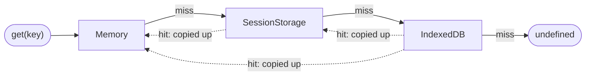

# pwa-cache-kit

[](https://github.com/rbalukja15/pwa-cache-kit/actions/workflows/ci.yml)

An offline-first cache for Progressive Web Apps that keeps each value in memory, SessionStorage
and IndexedDB, and reads it from the fastest tier that has it.

> **Status:** early development. The API is specified in
> [ADR-0002](./docs/adr/0002-cache-api-and-semantics.md) and is being implemented; nothing is
> published to npm yet.

## The three tiers

| Tier           | Shared by                          | Survives                               | Access                                |
| -------------- | ---------------------------------- | -------------------------------------- | ------------------------------------- |
| Memory         | one page or worker                 | nothing: lost on reload                | synchronous, any value                |
| SessionStorage | one tab (windows only)             | reloads of that tab                    | synchronous, JSON-safe values         |
| IndexedDB      | all tabs and workers of the origin | restarts, unless the browser evicts it | asynchronous, structured-clone values |

Each kind of data lives in a namespace that sets the tiers holding it (its **tier policy**), its
time to live and its schema version. Reads check the policy's tiers from the top and stop at the
first fresh copy. A copy found lower down is promoted to the tiers above it, so the next read is
fast. Writes go to every tier in the policy.



Which tiers to pick for which data is covered in the
[decision guide](./docs/decision-guide.md), and why there are three tiers in
[ADR-0001](./docs/adr/0001-three-tier-cache.md).

## Planned API

A sketch of the API from ADR-0002. It does not work yet.

```ts
import { createCache, indexedDBTier, memoryTier } from '@rbalukja/pwa-cache-kit';

interface Ticket {
  id: string;
  seat: string;
}

const cache = createCache({ name: 'app', tiers: [memoryTier(), indexedDBTier()] });

// Tier failures are reported as events, never thrown from reads, so log them while developing.
cache.on('error', (event) => console.warn(event.error));

const tickets = cache.namespace<Ticket>('tickets', {
  tiers: ['memory', 'indexeddb'],
  ttlMs: 5 * 60_000,
});

await tickets.set('t1', { id: 't1', seat: '12A' });
const cached = await tickets.get('t1'); // Ticket | undefined
```

## Server-side rendering

Outside the browser (Node, SSR and edge runtimes) the cache is inert, the memory tier included:
reads miss and writes store nothing. Server requests therefore never share cached data, and the
same code runs on the server and in the browser.

## Roadmap

1. [M0: Project setup and documentation](https://github.com/rbalukja15/pwa-cache-kit/milestone/1):
   scaffold, CI, ADRs and this README.
2. [M1: Core typed API](https://github.com/rbalukja15/pwa-cache-kit/milestone/2): the typed cache
   API with tier policies and TTLs, the memory tier, and `getOrSet` with stale-while-revalidate.
3. [M2: Three-tier storage](https://github.com/rbalukja15/pwa-cache-kit/milestone/3): the
   SessionStorage and IndexedDB tiers, size budgets and eviction, events, and cross-tab
   invalidation.
4. [M3: Schema migrations](https://github.com/rbalukja15/pwa-cache-kit/milestone/4): versioned
   values migrated on read.
5. [M4: Demo PWA and cache inspector](https://github.com/rbalukja15/pwa-cache-kit/milestone/5): an
   offline ticket wallet that shows which tier served each read.
6. [M5: Benchmarks and decision guide](https://github.com/rbalukja15/pwa-cache-kit/milestone/6):
   read latency per tier and quota behavior across browsers.
7. [M6: Publish and release](https://github.com/rbalukja15/pwa-cache-kit/milestone/7): the npm
   package, a bundle-size budget, the hosted demo and v1.0.

## Design documents

- [Architecture decision records](./docs/adr/README.md)
- [Decision guide](./docs/decision-guide.md) (outline until M5)
- [Development log](./docs/devlog.md)
